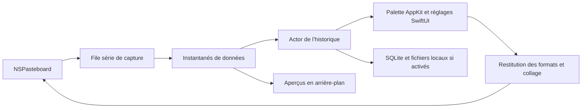

# mcm

Gestionnaire de presse-papiers personnel pour **macOS 27 sur Apple Silicon**, écrit en Swift avec AppKit et des réglages SwiftUI. Il reprend le fonctionnement de l’historique de Quicksilver : palette flottante, dernières copies en tête et collage immédiat par numéro.

## Compiler et ouvrir

Prérequis : macOS 27 et Xcode avec les outils de développement Swift sélectionnés.

```sh
cd /Users/arthur/workspace/mcm
swift test
./scripts/build-app.sh
open build/mcm.app
```

Le script compile en mode release, génère l’icône et crée `build/mcm.app`. Il applique une signature locale ad hoc par défaut. Une identité de signature disponible dans le trousseau peut être fournie explicitement :

```sh
MCM_SIGN_IDENTITY='Developer ID Application: Your Name (TEAMID)' ./scripts/build-app.sh
```

Le projet peut aussi être ouvert dans Xcode via `Package.swift`. L’application reste dans la barre de menus après fermeture de sa fenêtre ; le menu de mcm permet de la quitter.

## Utiliser l’historique

- **⌥A** ouvre ou masque la palette ; le raccourci initial est résolu selon la disposition du clavier. Si Quicksilver utilise déjà cette combinaison, libérer son raccourci ou choisir une autre combinaison dans mcm.
- **1 à 9** collent les neuf premières lignes. Les touches de la rangée numérique fonctionnent aussi sur AZERTY. Les flèches déplacent la sélection ; Entrée ou un double-clic collent la sélection ; Échap masque la palette.
- Une nouvelle copie arrive au rang 1. Une copie strictement identique et une entrée recollée remontent en tête sans créer de doublon. Deux versions ayant une mise en forme différente restent distinctes.
- Le collage revient dans l’application utilisée avant l’ouverture de mcm. La palette se masque ensuite par défaut.
- L’engrenage, le menu de mcm et **⌘,** donnent accès aux réglages. La longueur d’historique, le budget de données, le raccourci, les aperçus, les tailles et le masquage après collage sont configurables.
- La taille de police de l’historique se règle de **10 à 28 points**, avec **12 points par défaut**. Le texte, les numéros et la hauteur des lignes s’adaptent immédiatement ; les tailles de police déjà choisies restent conservées.
- La fenêtre apparaît et disparaît **instantanément par défaut**, sans fondu. Le réglage des animations permet de réactiver le comportement natif de macOS.
- L’interface est disponible en **français et en anglais**, avec la langue système par défaut. Le choix dans les réglages actualise immédiatement la fenêtre, les menus et les commentaires des entrées. Le contenu copié reste intact.
- La position est fixe par défaut. Le mode d’ouverture au pointeur est optionnel ; un petit sélecteur carré choisit le quadrant **haut gauche, haut droite, bas gauche ou bas droite**, avec **bas droite par défaut**. La fenêtre reste dans la zone utilisable de l’écran ; déplacer la palette la fixe à son nouvel emplacement sans perdre le quadrant choisi.
- La largeur de la palette peut descendre jusqu’à **280 points**.

Les valeurs initiales sont **20 entrées**, **256 Mio de données**, police de **12 points**, aperçus et tailles affichés, persistance et animations désactivées. Les limites s’appliquent aux entrées entières : mcm ne retire pas certains formats d’une copie pour la faire tenir dans le budget.

## Autorisations et conservation

Autoriser la lecture du presse-papiers dans les Réglages Système lorsqu’elle est demandée. Pour envoyer le collage à une autre application, accorder également l’autorisation **Accessibilité** à mcm ; les réglages de mcm proposent les accès correspondants. Si le collage automatique est indisponible, l’entrée est recopiée dans le presse-papiers et peut être collée manuellement avec **⌘V**.

Sans persistance, les contenus de l’historique restent en mémoire. Activer la conservation enregistre l’historique courant et les copies suivantes dans `~/Library/Application Support/mcm/History/`. La désactiver supprime cette sauvegarde et conserve l’historique de la session en mémoire. Un échec de sauvegarde est signalé et laisse les copies disponibles en mémoire.

Les fichiers du Finder sont conservés comme **références aux originaux**, pas comme archives indépendantes. Le collage vérifie qu’ils existent encore. Les données d’image originales, les formats et les métadonnées fournis par l’application source sont conservés ; une miniature ne remplace jamais l’original. Aucune fonctionnalité réseau ni journalisation du contenu des copies n’est ajoutée par mcm.

## Fidélité et architecture

Une entrée contient tous les éléments du presse-papiers, leurs représentations et leurs octets : texte pur, HTML, RTF, images, URL de fichiers et formats privés disponibles. Les espaces, tabulations, encodages et fins de ligne ne sont pas normalisés. Les représentations différées sont matérialisées pendant la capture ; les objets AppKit périmés ne sont jamais conservés dans l’historique. Une capture incomplète est indiquée et son collage automatique est bloqué.



La capture est isolée de l’interface ; l’actor sérialise les modifications de l’historique et de sa sauvegarde. Les aperçus sont calculés en arrière-plan et la restitution reconstruit de nouveaux objets AppKit. Une petite passerelle Objective-C transforme les exceptions `NSException` des échanges avec le presse-papiers en erreurs récupérables.

La surveillance commence à **200 ms**. Plusieurs copies remplacées entre deux lectures peuvent donc ne pas être capturées. Les tests contrôlent la restitution des octets et des formats privés simulés ; la fidélité réelle de Word et Excel doit encore être comparée à leur collage direct. Les formats privés dépendant de l’état de leur application source ne sont pas nécessairement autonomes.

## Aperçu et mesures

Pour examiner l’interface avec des exemples, sans lire l’historique réel :

```sh
./scripts/preview-app.sh
open 'build/mcm Preview.app'
```

Cette application utilise un presse-papiers privé et des préférences de démonstration distinctes. Elle ne teste pas le collage réel dans une autre application.

Après avoir quitté mcm, le mode suivant affiche uniquement des durées d’ouverture dans le terminal :

```sh
./build/mcm.app/Contents/MacOS/mcm --measure
```

**Aucun quota CPU n’est imposé.** L’objectif d’ouverture à chaud sous 50 ms au 95e percentile reste à mesurer ; `--measure` indique la durée du chemin d’ouverture AppKit, sans journaliser le contenu et sans constituer à lui seul une mesure du premier affichage complet. Les ressources seront ajustées selon les observations. Le détail des contrôles effectués et restant à faire est dans [docs/VALIDATION.md](docs/VALIDATION.md).
