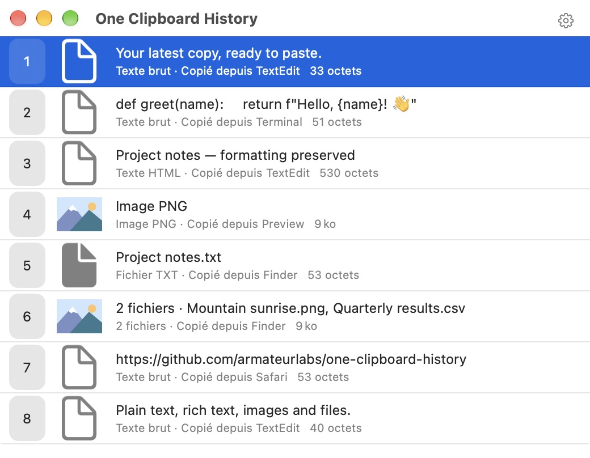
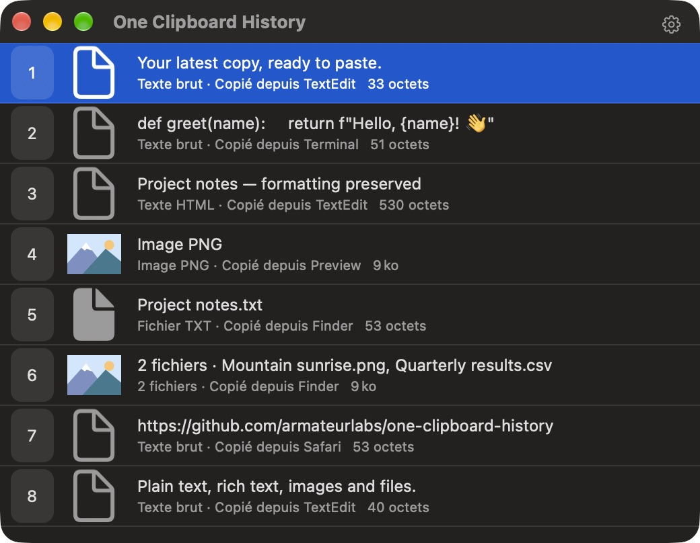
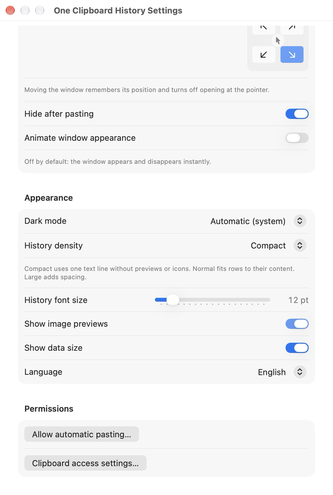

# One Clipboard History

Un historique du presse-papiers natif pour **macOS 27 sur Apple Silicon**, écrit en Swift avec AppKit et des réglages SwiftUI. Inspiré de la rapidité de l’historique de Quicksilver : **⌥A → un chiffre → coller**.

[English](README.en.md) · [Téléchargements](https://github.com/armateurlabs/one-clipboard-history/releases) · [Licence MIT](LICENSE) · [Confidentialité](PRIVACY.md)

| Mode normal, clair | Mode normal, sombre |
| --- | --- |
|  |  |

Les captures montrent l’application réelle avec des données synthétiques, sans contenu personnel.

## Utilisation

1. Copier du texte, du contenu enrichi, une image ou des fichiers normalement.
2. Appuyer sur **⌥A** pour afficher ou masquer l’historique.
3. Appuyer sur **1 à 9** pour coller l’entrée correspondante dans l’application précédente.

Les flèches sélectionnent une ligne ; **Entrée** ou un double-clic colle la sélection ; **Échap** masque la fenêtre. L’engrenage et **⌘,** ouvrent les réglages. Le raccourci est configurable, y compris pour éviter un conflit avec Quicksilver.

- Dernière copie au rang 1 ; les doublons strictement identiques remontent en tête. Les mises en forme différentes restent distinctes.
- Texte pur, HTML, RTF, images, références de fichiers et représentations privées disponibles sont conservés sans normaliser leurs octets. Miniatures et résumés sont séparés des originaux.
- **20 entrées**, **256 Mio**, police **12 points**, mode compact et tailles affichées par défaut.
- Trois densités : **compact** sur une ligne sans aperçu ni icône, avec numéro à hauteur du texte ; **normal** avec aperçu et deux lignes ajustées au contenu ; **large** avec davantage d’espace. La police reste identique dans les trois modes. Les détails restent accessibles au survol et aux technologies d’assistance en mode compact.
- Fenêtre instantanée, sans fondu par défaut ; animations facultatives. Largeur minimale de 280 points.
- Position fixe mémorisée ou ouverture au pointeur, avec choix de quatre quadrants ; bas à droite par défaut. Déplacer la fenêtre la fixe à son nouvel emplacement.
- Mode sombre **activé / désactivé / automatique**, français/anglais avec changement de langue immédiat, police réglable de 10 à 28 points.
- Persistance et lancement silencieux à l’ouverture de session **désactivés par défaut**.

Les installations existantes conservent leur disposition : l’ancienne vue compacte devient **normal**, l’ancienne vue espacée devient **large**. Le choix des aperçus reste mémorisé lorsqu’on utilise le mode compact.



## Installation

Télécharger le ZIP depuis [Releases](https://github.com/armateurlabs/one-clipboard-history/releases), l’extraire et placer **One Clipboard History.app** dans Applications. Quitter l’ancienne application avant de la remplacer.

**État de la version 0.8.0 :** la version personnelle est signée localement (ad hoc). La signature Developer ID et la notarisation nécessitent un certificat Apple ; un build local n’est pas une distribution validée par Gatekeeper. Le projet prépare une variante Mac App Store, sans annoncer sa disponibilité sur le Store. Voir le [dossier de préparation](docs/APP_STORE.md) et les [preuves de validation](docs/VALIDATION.md).

L’application démarre dans la barre de menus. Fermer la fenêtre laisse la capture active ; **Quitter One Clipboard History** l’arrête. Dans Réglages → Général, l’option de lancement à la connexion reste silencieuse et respecte les changements effectués dans macOS.

## Permissions et confidentialité

- Autoriser l’accès au presse-papiers quand macOS le demande. Au lancement en arrière-plan, les demandes de permission attendent une interaction explicite.
- Autoriser l’envoi de raccourcis dans les réglages de confidentialité macOS pour le collage automatique. Si l’autorisation manque, l’entrée est recopiée et reste collable manuellement avec **⌘V**.
- Les fichiers du Finder restent des **références aux originaux**. Leur existence et leur accessibilité sont vérifiées ; ils ne sont pas archivés avec l’historique.
- Aucun compte, publicité, télémétrie ou envoi du contenu du presse-papiers. Les liens GitHub ne s’ouvrent que sur action explicite.

Sans persistance, l’historique reste en mémoire et disparaît à la fermeture. Son activation sauvegarde les copies localement ; sa désactivation supprime la sauvegarde en conservant la session mémoire. Le stockage n’est pas chiffré par l’application. « Effacer l’historique » ne supprime jamais les fichiers originaux.

Pour conserver les réglages des premières versions, la distribution directe utilise toujours l’identifiant `com.arthur.mcm` et `~/Library/Application Support/mcm/History/`. La variante sandboxée possède son propre conteneur et propose un import explicite d’un ancien dossier History, sans modifier la source.

Lire la [politique de confidentialité complète](PRIVACY.md), également accessible dans À propos.

## Compiler

Prérequis : macOS 27, Apple Silicon et Xcode 27 avec ses outils de ligne de commande sélectionnés.

```sh
git clone https://github.com/armateurlabs/one-clipboard-history.git
cd one-clipboard-history
swift test
./scripts/build-app.sh
open 'build/One Clipboard History.app'
```

Le script génère une icône originale et un bundle signé localement, avec ses traductions, sa licence et sa politique de confidentialité. Une identité disponible dans le trousseau peut être fournie avec `OCH_SIGN_IDENTITY` (l’ancien `MCM_SIGN_IDENTITY` reste accepté).

```sh
./scripts/validate-app.sh 'build/One Clipboard History.app'
./scripts/preview-app.sh
open 'build/One Clipboard History Preview.app'
```

L’aperçu utilise un presse-papiers privé, des préférences distinctes et un service de lancement simulé. Il permet de photographier et d’examiner l’interface sans capturer l’historique réel.

La cible Xcode **OneClipboardHistory Store** prépare le sandbox et l’archivage. Les commandes, exigences de signature et résultats de faisabilité sont décrits dans [APP_STORE.md](docs/APP_STORE.md).

## Fidélité, performances et limites

La capture lit le presse-papiers toutes les **200 ms**, sur une file dédiée. Les copies intermédiaires remplacées entre deux lectures peuvent échapper à l’historique. Les formats différés sont matérialisés pendant la capture ; une entrée incomplète est signalée et son collage est bloqué. L’éviction concerne des entrées entières, jamais certains formats d’une copie.

La restitution recrée des objets AppKit indépendants. Les formats privés de Word et Excel peuvent dépendre de l’application source : les tests d’octets ne prouvent pas à eux seuls la fidélité fonctionnelle d’Office. Les scénarios vérifiés et restant à effectuer sont documentés dans [VALIDATION.md](docs/VALIDATION.md).

**Limite Excel constatée :** une ancienne copie peut coller les valeurs calculées à la place des formules, même lorsque tous ses formats et octets sont conservés. Les entrées concernées portent une indication et demandent confirmation avant leur restauration. Si la copie est toujours intacte dans le presse-papiers, l’application conserve son propriétaire et le comportement du collage direct. Aucun format original n’est retiré pour contourner cette limite.

Aucun quota CPU n’est imposé. L’objectif d’ouverture à chaud est un 95e percentile sous 50 ms ; les mesures précisent ce qui a effectivement été chronométré. Le mode `--measure` ne journalise que des durées, jamais le contenu copié.

## Contribuer

Ouvrir une [issue](https://github.com/armateurlabs/one-clipboard-history/issues) avec la version de macOS, la version de l’application et des étapes reproductibles. Utiliser des exemples synthétiques : ne pas publier de secrets ou d’historique personnel. Exécuter `swift test` et les vérifications du bundle avant de proposer un changement.

Copyright © 2026 **Armateur Labs**. Distribué sous [licence MIT](LICENSE).
